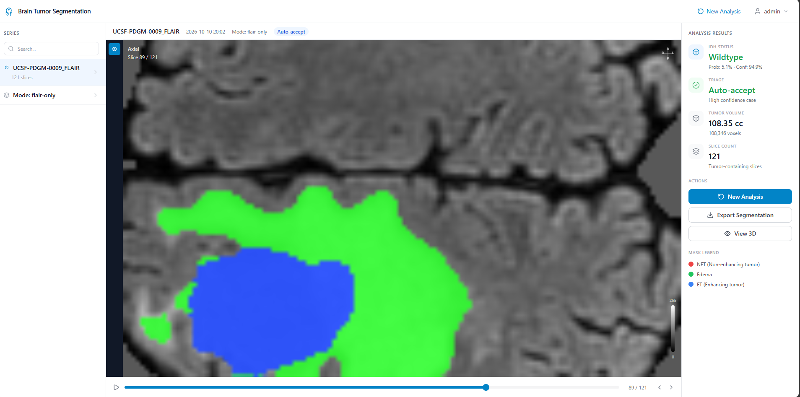

# MTamba 2D Feasibility: Missing-Modality Robustness + Uncertainty Triage

2D proxy study for MICCAI 2025 "Tetra-Orientated Mamba with T2-FLAIR Mismatch Features for Glioma Segmentation, IDH Genotyping and Grading" (MTamba).



## Motivation

Full 3D MTamba reproduction requires A100-class GPUs and a custom Mamba fork — not feasible in 48h on consumer hardware. This project tests the **core scientific hypothesis** with a lightweight 2D U-Net:
- Can a segmentation+IDH model learn to operate when MRI sequences are missing?
- Can MC-dropout confidence scores drive a "refer to radiologist" triage workflow?

## What we did

| Component | Description |
|-----------|-------------|
| Dataset | UCSF-PDGM (n=50, 4-modalities + segmentation + IDH labels) |
| Model | 2D U-Net (2.4M params) with modality-dropout training (p=0.3) |
| Task 1 | Missing-modality evaluation: full-4 / FLAIR-only / T2+FLAIR / no-T1CE |
| Task 2 | MC-dropout uncertainty triage: accuracy–coverage curve |
| Stack | React + Tailwind frontend, FastAPI + PyTorch backend |

## Key Results

- **WT Dice 0.83** maintained even without contrast dye (no-T1CE mode)
- **IDH AUC 0.889** preserved in contrast-free setting
- **Uncertainty triage**: 100% accuracy on 80% highest-confidence cases → 20% referred

## Quick Start

### Backend

```bash
cd server
pip install -r requirements.txt
uvicorn main:app --reload --port 8000
```

### Frontend

```bash
npm install
npm run dev
```

Upload FLAIR + T1 + T1CE + T2 `.nii.gz` files, select inference mode, run analysis.

## Repo Structure

```
├── server/          # FastAPI backend (preprocess + inference)
├── src/             # React frontend
├── work/            # Model checkpoint (best.pt)
└── notebook/        # Training notebook (mtamba_2d_feasibility.ipynb)
```

## Citation

- **Paper:** MICCAI 2025 — MTamba (Liu et al.)
- **Dataset:** UCSF-PDGM (TCIA, CC BY 4.0)

## Future Work

- Full 3D MTamba reproduction with custom Mamba kernel
- Scale to complete UCSF-PDGM (n=495) + BraTS2020
- Add 1p/19q co-deletion as 4th task
